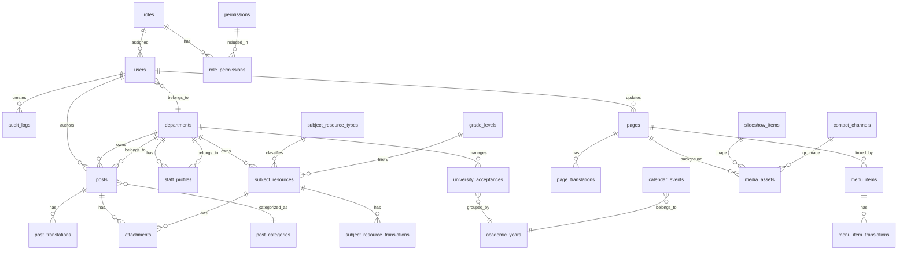

# ERD - CMS Website Jakarta Taipei School

Dokumen ini adalah rancangan data untuk implementasi PHP + MySQL + Bootstrap + jQuery sesuai arahan `web.pdf`. Model dibuat agar bisa memuat konten lama dan kebutuhan baru seperti admin panel per departemen, News & Media, subject resource, upload file, QR, slideshow, dan multi-bahasa English/Mandarin/Indonesian dengan English sebagai default.

## 1. Mermaid ERD

## 2. Tabel Inti

### users

| Field | Type | Notes |
| --- | --- | --- |
| id | bigint PK | |
| department_id | bigint FK nullable | Null untuk super admin/global |
| role_id | bigint FK | |
| name | varchar(150) | |
| email | varchar(191) unique | |
| password_hash | varchar(255) | |
| status | enum(active,inactive) | |
| last_login_at | datetime nullable | |
| created_at, updated_at | datetime | |

### roles

| Field | Type | Notes |
| --- | --- | --- |
| id | bigint PK | |
| code | varchar(50) unique | super_admin, content_admin, department_admin, viewer |
| name | varchar(100) | |

### permissions

| Field | Type | Notes |
| --- | --- | --- |
| id | bigint PK | |
| code | varchar(100) unique | contoh: posts.create, resources.update |
| description | varchar(255) | |

### role_permissions

| Field | Type | Notes |
| --- | --- | --- |
| role_id | bigint FK | |
| permission_id | bigint FK | |

### departments

| Field | Type | Notes |
| --- | --- | --- |
| id | bigint PK | |
| code | varchar(50) unique | secretary, academic, student_affairs, languages, kindergarten, clc, general_affairs, accounting, hr |
| name | varchar(150) | |
| sort_order | int | |
| is_active | boolean | |

## 3. Menu dan Halaman Statis

### pages

| Field | Type | Notes |
| --- | --- | --- |
| id | bigint PK | |
| slug | varchar(191) unique | contoh: about, academics, admissions |
| template | varchar(80) | default, academics, admission, staff |
| status | enum(draft,published,archived) | |
| hero_image_id | bigint FK nullable | ke media_assets |
| background_image_id | bigint FK nullable | untuk student work/page background |
| published_at | datetime nullable | |
| created_by, updated_by | bigint FK users | |
| created_at, updated_at | datetime | |

### page_translations

| Field | Type | Notes |
| --- | --- | --- |
| id | bigint PK | |
| page_id | bigint FK | |
| locale | varchar(10) | en, zh-TW, id |
| title | varchar(191) | |
| summary | text nullable | |
| body | longtext | |
| seo_title | varchar(191) nullable | |
| seo_description | varchar(255) nullable | |

Aturan:
- Wajib ada row `locale = en` untuk setiap page yang dipublish.
- Locale yang didukung: `en`, `zh-TW`, `id`.

### menu_items

| Field | Type | Notes |
| --- | --- | --- |
| id | bigint PK | |
| parent_id | bigint FK nullable | untuk dropdown |
| page_id | bigint FK nullable | jika internal page |
| label | varchar(150) | label default |
| url | varchar(255) nullable | untuk external/download link |
| menu_area | enum(header,footer,utility) | |
| sort_order | int | |
| is_active | boolean | |

### menu_item_translations

| Field | Type | Notes |
| --- | --- | --- |
| id | bigint PK | |
| menu_item_id | bigint FK | |
| locale | varchar(10) | en, zh-TW, id |
| label | varchar(150) | |

## 4. News & Media

### post_categories

| Field | Type | Notes |
| --- | --- | --- |
| id | bigint PK | |
| code | varchar(80) unique | news, media, activity, exchange, newsletter, admission_notice |
| name | varchar(150) | |

### posts

| Field | Type | Notes |
| --- | --- | --- |
| id | bigint PK | |
| category_id | bigint FK | |
| department_id | bigint FK nullable | filter Department di PDF |
| slug | varchar(191) unique | |
| topic | varchar(191) | field "topic" di PDF |
| status | enum(draft,published,archived) | |
| upload_date | date | untuk sort by date upload |
| published_at | datetime nullable | |
| created_by, updated_by | bigint FK users | |
| created_at, updated_at | datetime | |

### post_translations

| Field | Type | Notes |
| --- | --- | --- |
| id | bigint PK | |
| post_id | bigint FK | |
| locale | varchar(10) | |
| title | varchar(191) | |
| excerpt | text nullable | |
| body | longtext nullable | |

Aturan:
- Wajib ada row `locale = en` untuk setiap post yang dipublish.
- Mandarin dan Indonesian boleh draft/missing, tetapi admin harus melihat status kelengkapannya.

## 5. Subject Resources

### grade_levels

| Field | Type | Notes |
| --- | --- | --- |
| id | bigint PK | |
| code | varchar(20) unique | tk, sd, smp, sma |
| name | varchar(80) | TK, SD, SMP, SMA |
| sort_order | int | |

### subject_resource_types

| Field | Type | Notes |
| --- | --- | --- |
| id | bigint PK | |
| code | varchar(80) unique | calendar, classroom_regulations, syllabus, textbook, lesson_progress, weekly_news |
| name | varchar(150) | |
| max_file_size_mb | int | default 15 |

### subject_resources

| Field | Type | Notes |
| --- | --- | --- |
| id | bigint PK | |
| type_id | bigint FK | |
| grade_level_id | bigint FK | |
| department_id | bigint FK nullable | |
| topic | varchar(191) | |
| upload_date | date | |
| status | enum(draft,published,archived) | |
| created_by, updated_by | bigint FK users | |
| created_at, updated_at | datetime | |

### subject_resource_translations

| Field | Type | Notes |
| --- | --- | --- |
| id | bigint PK | |
| subject_resource_id | bigint FK | |
| locale | varchar(10) | en, zh-TW, id |
| title | varchar(191) | |
| description | text nullable | |

## 6. File, Gambar, QR, Slideshow

### media_assets

| Field | Type | Notes |
| --- | --- | --- |
| id | bigint PK | |
| uploaded_by | bigint FK users | |
| disk_path | varchar(255) | |
| original_name | varchar(255) | |
| mime_type | varchar(120) | |
| extension | varchar(20) | |
| size_bytes | bigint | |
| alt_text | varchar(255) nullable | |
| usage_type | enum(image,qr,background,student_work,document) | |
| created_at | datetime | |

### attachments

| Field | Type | Notes |
| --- | --- | --- |
| id | bigint PK | |
| attachable_type | varchar(80) | post atau subject_resource |
| attachable_id | bigint | |
| media_asset_id | bigint FK | |
| sort_order | int | default 1 |

Aturan:
- News & Media: 1 attachment per item, format doc/docx/pdf/rar, maksimal 15 MB.
- Subject Resources: minimal 1 attachment per item, format dokumen sesuai kebutuhan, maksimal 15 MB/file.

### slideshow_items

| Field | Type | Notes |
| --- | --- | --- |
| id | bigint PK | |
| topic | varchar(191) | |
| image_id | bigint FK media_assets | |
| link_url | varchar(255) nullable | |
| sort_order | int | maksimal 10 aktif |
| is_active | boolean | |
| created_by, updated_by | bigint FK users | |
| created_at, updated_at | datetime | |

Aturan:
- Satu topik hanya memiliki satu gambar aktif.
- Ukuran gambar maksimal 1 MB bila mengikuti PDF.
- Jika jumlah aktif sudah 10, upload baru ditolak atau mengganti item lama sesuai keputusan final.

### contact_channels

| Field | Type | Notes |
| --- | --- | --- |
| id | bigint PK | |
| channel | enum(admission_tel,phone,instagram,whatsapp,tiktok,address,email) | |
| label | varchar(150) | |
| value | varchar(255) | nomor, URL, alamat |
| qr_image_id | bigint FK nullable | |
| is_visible_header | boolean | |
| is_visible_footer | boolean | |
| sort_order | int | |

## 7. Data Pendukung

### academic_years

| Field | Type | Notes |
| --- | --- | --- |
| id | bigint PK | |
| code | varchar(30) unique | contoh 114-2, 115-1 |
| starts_on | date nullable | |
| ends_on | date nullable | |
| is_active | boolean | |

### university_acceptances

| Field | Type | Notes |
| --- | --- | --- |
| id | bigint PK | |
| academic_year_id | bigint FK | |
| student_name | varchar(150) | |
| admission_path | varchar(150) nullable | |
| university_name | varchar(191) | |
| program_name | varchar(191) nullable | |
| country | varchar(100) nullable | |
| sort_order | int | |

### staff_profiles

| Field | Type | Notes |
| --- | --- | --- |
| id | bigint PK | |
| department_id | bigint FK | |
| name | varchar(150) | |
| title | varchar(150) | |
| extension | varchar(50) nullable | |
| responsibilities | text nullable | |
| photo_id | bigint FK nullable | |
| sort_order | int | |
| is_active | boolean | |

### audit_logs

| Field | Type | Notes |
| --- | --- | --- |
| id | bigint PK | |
| user_id | bigint FK nullable | |
| action | varchar(80) | create, update, delete, publish, login |
| entity_type | varchar(80) | |
| entity_id | bigint nullable | |
| ip_address | varchar(45) nullable | |
| user_agent | varchar(255) nullable | |
| created_at | datetime | |

## 8. Index yang Disarankan

- `posts(upload_date, status)`
- `posts(department_id, category_id, status)`
- `post_translations(title)`
- `subject_resources(type_id, grade_level_id, upload_date, status)`
- `media_assets(extension, mime_type, size_bytes)`
- `menu_items(parent_id, menu_area, sort_order)`
- `staff_profiles(department_id, sort_order)`
- `university_acceptances(academic_year_id, university_name)`

## 9. Catatan Implementasi

- Gunakan `utf8mb4_unicode_ci` untuk seluruh tabel.
- Simpan file upload di folder non-public atau gunakan handler download agar file executable tidak bisa dijalankan.
- Simpan path relatif di database, bukan absolute path server.
- Untuk admin departemen, semua query update/delete wajib dicek `department_id` kecuali role super admin.
- Website wajib multi-bahasa: `en` default, `zh-TW` untuk Mandarin, dan `id` untuk Indonesian.
- Gunakan tabel translation sejak awal untuk page, menu, post, dan subject resource. Jangan membuat tiga record konten terpisah untuk tiga bahasa.
- Tambahkan unique index pada pasangan translation, misalnya `(page_id, locale)`, `(post_id, locale)`, `(menu_item_id, locale)`, dan `(subject_resource_id, locale)`.
